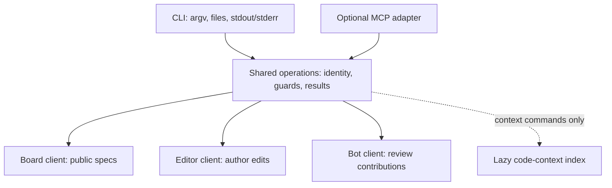

# Give SpecDoc agents a dependable CLI

Build a **CLI as the default interface for agents with shell access**, backed by shared application operations and direct HTTP clients. Keep MCP as an optional adapter for hosts that need it. Ordinary document reads and edits should require neither a repository checkout nor code indexing. Make browser login a first-class workflow: print a link, let the user authorize in their browser, and authenticate the waiting terminal automatically. Support both a local callback and device authorization for remote terminals. The hardest work is preserving SpecDoc's editing and identity semantics, not replacing the transport; a CLI does not by itself provide safer retries or lower cost.

**Evidence as of 2026-10-20.** Repository findings describe the dirty working tree at HEAD `3fa853742f5df5572cbe4ef9cc7a9759dcaa979a`, including existing changes to the APIs, MCP implementation, documentation and editor bundle. They do **not** confirm production behavior or account permissions. Third-party observations come from documentation retrieved on that date; implementation details absent from those sources remain unknown. Commands, contracts and architecture below are proposals, not implemented features. The four [source notes](../README.md) retain detailed evidence and unresolved questions.

## Share operations while keeping ordinary commands cheap

SpecDoc already has three distinct public interfaces. Preserve their identities and permissions instead of presenting every write as interchangeable. ([Repository analysis](../research_notes/SpecDoc%20CLI%20for%20agents/specdoc-architecture.md), [API documentation](../../docs/api.md))

| Existing interface | What it provides | Boundary the CLI must preserve |
|---|---|---|
| Board `/api/specs` | Public metadata, detail, revisions and review snapshots/diffs | Detail `body` strips frontmatter and resolves CriticMarkup. This is publication-ready text, not necessarily an already published revision or an editable source copy. |
| Editor `/api/v1/notes` | PAT-authenticated raw read, creation and full-content replacement | User permissions, `notes:read`/`notes:write`, exact ETag and exclusion of active editors. Saved text can lag an open editor. |
| Board `/api/bot/notes` | Raw content/hash, threads, comments, suggestions and replies | Bot identity, configured namespaces and public notes. Suggestions do not constitute direct author edits. |

The internal editor mutation interface has durable receipts, but requires server-to-server assertions and deployment secrets. It is backend infrastructure, not a credential agents should receive. The current shell entry point, `node mcp/server.js <tool> …`, initializes checkout indexing, Git history and board context; tree-sitter loads at import. Unknown commands can fall through into MCP serving. Extract useful client and resolution logic rather than wrapping that entry point. ([Repository analysis](../research_notes/SpecDoc%20CLI%20for%20agents/specdoc-architecture.md))



The shared layer should own reference resolution, authentication context, preconditions, retry classification and result types. Adapters own their presentation and transport. Start in Node to reuse the existing JavaScript implementation; a Go or Rust executable is a distribution option to evaluate later, not a demonstrated performance improvement. Remote CRUD must work from an empty directory without Git or tree-sitter. Keep local context analysis an explicit, lazily loaded capability. ([Repository analysis](../research_notes/SpecDoc%20CLI%20for%20agents/specdoc-architecture.md))

Profiles should distinguish board and editor origins and bind each credential to its intended origin. Validate pasted URLs before resolving their identifiers; never forward credentials to an arbitrary host or cross-origin redirect. Preserve `bR0-jQzDTtiBkdjuywpYEg` from the user's URL. Do not infer `#6` from `SPEC-006`: current board `owner/repo#N` references use PR numbers, while editor resolution supports aliases and several ID forms. ([Repository analysis](../research_notes/SpecDoc%20CLI%20for%20agents/specdoc-architecture.md), [bearer-token guidance](https://www.rfc-editor.org/rfc/rfc6750.html#section-5.3))

MCP remains useful when a host cannot run local programs. It supports both subprocess and HTTP transports; it does not inherently require a separately deployed service. Its July 2026 revision also differs from older session/initialization descriptions, so implementation planning must check actual host compatibility. Progressive discovery and code composition can improve either interface. **No reviewed evidence establishes that this CLI will intrinsically be faster or cheaper.** ([Transport analysis](../research_notes/SpecDoc%20CLI%20for%20agents/transport-and-evaluation.md), [MCP transports](https://modelcontextprotocol.io/specification/2026-07-28/basic/transports), [MCP changes](https://modelcontextprotocol.io/specification/2026-07-28/changelog), [Anthropic on code execution](https://www.anthropic.com/engineering/code-execution-with-mcp))

## Make the command contract predictable without a terminal

Use a small workflow vocabulary. These illustrative groups expose existing capabilities and proposed client conveniences; they do not imply that every server endpoint already exists.

```text
specdoc auth    login | status | logout
specdoc spec    list | get | revisions
specdoc note    get | checkout | diff | create | update
specdoc review  get | comment | suggest | reply
specdoc context query | trace
specdoc schema  OPERATION
```

`spec` reads the board view; `note` reads or edits raw author source; `review` acts as the configured bot. Never silently fall back from author editing to suggestions. Maintain one operation registry for arguments, schemas, side effects, help and examples. Help and per-operation schemas must work offline. Version the executable and output contract separately, and report server capabilities rather than assuming them. GitHub CLI demonstrates selected JSON fields and predictable non-TTY behavior; `gws` demonstrates per-method schema discovery, although its README warns that it is pre-v1 and not an officially supported Google product. ([CLI-contract research](../research_notes/SpecDoc%20CLI%20for%20agents/cli-contracts.md), [GitHub CLI agent guidance](https://raw.githubusercontent.com/cli/cli/trunk/skills/gh/SKILL.md), [Workspace CLI](https://raw.githubusercontent.com/googleworkspace/cli/main/README.md))

| Contract | Recommended behavior |
|---|---|
| Successful output | `--format json` emits one versioned JSON document on stdout; raw Markdown emits only stored content, without decoration or an invented newline. |
| Failures | Empty stdout and a structured stderr error in JSON mode, including parser errors. Stable string codes drive recovery; messages explain it. |
| Exit status | Start with `0` success, `2` local usage/validation and `1` other failure; document interruption separately. Error codes distinguish conflicts, permissions and uncertain outcomes. |
| Content input | `--body-file PATH`, with `-` explicitly selecting stdin. Reject missing or conflicting input; do not launch an editor or opportunistically read stdin. |
| Pagination | A documented bounded default, maximum `--limit`, opaque continuation and explicit completion. Preserve paging metadata when selecting fields. |
| Automation | Ordinary commands never prompt, open a browser/editor or start a pager. `--non-interactive` also enforces this under a PTY. |
| Parsing | Exact canonical commands, flags, enums and fields; reject unknown or duplicate single-valued arguments before requests. |

For example:

```sh
specdoc spec list --limit 20 --fields id,title,url --format json
specdoc schema note.update --format json
```

A list envelope can contain `schemaVersion`, `data`, and `page: {nextCursor, complete}`. It must distinguish a bounded result from the complete collection. Whole-collection export or NDJSON streaming should be explicit later features with defined termination and partial-failure behavior. Existing CLIs differ substantially: AWS auto-paginates and enables a pager by default, while its JSON errors retain exceptions. Specify and test SpecDoc's own behavior rather than assuming familiar flags imply a universal contract. ([CLI-contract research](../research_notes/SpecDoc%20CLI%20for%20agents/cli-contracts.md), [AWS pagination](https://docs.aws.amazon.com/cli/latest/userguide/cli-usage-pagination.html), [AWS structured errors](https://docs.aws.amazon.com/cli/latest/userguide/cli-usage-error-format.html))

The earlier `ip a sh` discussion concerned netfyr, not SpecDoc. **Do not introduce arbitrary prefix matching as an automation contract.** Fixed aliases can be added deliberately. AWS's warning that new options can break previously unambiguous abbreviations illustrates the compatibility problem, though its example concerns option prefixes. Treat remote Markdown, titles and comments as untrusted data: escape terminal controls in human rendering, preserve source identity, and never execute embedded instructions or interpolate document bodies into shell commands. ([CLI-contract research](../research_notes/SpecDoc%20CLI%20for%20agents/cli-contracts.md), [AWS abbreviation warning](https://docs.aws.amazon.com/cli/latest/userguide/cli-chap-troubleshooting.html))

## Preserve complete source and report uncertain writes honestly

**An author edit must start from complete editor source and its exact strong ETag.** Board-rendered text and token-clipped MCP output are unsafe replacement bases. The editor ETag covers more than content and is distinct from the bot API's SHA-256 content hash. Current editor writes require the exact guard: missing guards produce 428, stale guards 412, and busy editor/save/update conditions 409; wildcard `If-Match` is insufficient. ([Repository analysis](../research_notes/SpecDoc%20CLI%20for%20agents/specdoc-architecture.md), [API contract](../../docs/api.md))

Proposed flow for the requested spec:

```sh
specdoc note checkout https://md.josie.cloud/bR0-jQzDTtiBkdjuywpYEg \
  --output spec.md --state spec.state.json
# Edit the complete raw file; preserve frontmatter and unrelated review markup.
specdoc note diff --state spec.state.json --body-file spec.md
specdoc note update --state spec.state.json --body-file spec.md --format json
```

The state file should retain canonical origin/ID, representation `raw`, original source and digest, exact quoted ETag and retrieval time—never credentials. Checkout must fail rather than silently truncate. Update validates the target and sends full content with the original `If-Match`; diff is a preview, not a server reservation. Define encoding and newline handling, and test any server normalization. A successful result returns canonical identity and the new guard, while publication remains separate asynchronous state. ([Repository analysis](../research_notes/SpecDoc%20CLI%20for%20agents/specdoc-architecture.md))

On 412, preserve local work and retrieve current source for reconciliation; do not simply replace the guard. On 409, distinguish a busy editor from a lifecycle restriction. PAT edits preserve unchanged-span authorship and attribute insertions to the token owner, but do not automatically perform the bot suggestion path's review retagging. Approved specs require an explicit author workflow back to `in-review`. Bot suggestions can reopen specs, and missing anchors can become comments: return `placed`/`unanchored` honestly instead of claiming the requested substitution succeeded. A strict “every anchor matches or nothing changes” mode needs server support. ([Repository analysis](../research_notes/SpecDoc%20CLI%20for%20agents/specdoc-architecture.md), [lifecycle documentation](../../docs/spec-lifecycle.md))

Connection loss after sending a write means **`outcome: unknown`**, not failure-before-commit. Retain target, old guard and intended digest. Reading matching content later establishes its current state, not which request authored it. HTTP idempotence and lost-update prevention do not provide transaction receipts. ([Repository analysis](../research_notes/SpecDoc%20CLI%20for%20agents/specdoc-architecture.md), [HTTP semantics](https://www.rfc-editor.org/rfc/rfc9110.html#section-13.1.1))

There is a concrete contradiction to resolve: the API documentation broadly describes repeated writes returning `written:false`, but comments/suggestions deduplicate by content while replies always append. Retrying a reply with its old hash conflicts; refreshing the hash and repeating can duplicate it. Public bot calls generate fresh internal operation IDs, and callers cannot query those receipts. PAT creation likewise lacks a public receipt contract. Before enabling automatic retries for these operations, add caller-supplied operation keys, actor/endpoint binding, payload fingerprints, durable results, changed-payload rejection and documented retention. Until then, preserve uncertainty and never blindly retry creation or replies. ([Repository analysis and exact source references](../research_notes/SpecDoc%20CLI%20for%20agents/specdoc-architecture.md))

## Let browser approval reach local and remote terminals

Codex and Claude Code both document a browser login with automatic local callback completion. Their remote fallbacks differ. These are observed product contracts, not proof of their internal OAuth implementation. ([Login research](../research_notes/SpecDoc%20CLI%20for%20agents/browser-login.md))

| Behavior | Codex documentation | Claude Code documentation |
|---|---|---|
| Entry and return | `codex login`; local callback documented at `localhost:1455` | Interactive login or `claude auth login`; local callback reports completion |
| Remote terminal | `--device-auth` uses link/code and polling; documented as beta with account/workspace enablement. SSH forwarding is another documented route. | Browser displays a code to paste if callback fails, including SSH/container/WSL2 cases |
| Storage/status | File, keyring, auto or ephemeral policy; `login status` reports credential presence/mode | macOS Keychain or private Linux credential file; `auth status` supports JSON |

Sources: [Codex authentication](https://learn.chatgpt.com/docs/auth), [Codex reference](https://learn.chatgpt.com/docs/cli/reference), [Claude authentication](https://code.claude.com/docs/en/authentication), [Claude reference](https://code.claude.com/docs/en/cli-reference). Installed CLI help was checked before the documentation research. **Exact PKCE, state, callback-port selection and refresh behavior were not established by the inspected product docs.** Claude's paste fallback is not evidence of RFC 8628. Its separate `setup-token` command prints a long-lived automation token; that should not define SpecDoc's normal login experience.

Recommend `specdoc auth login` print an HTTPS link and optionally open the external browser when interactive. Start a temporary listener on a loopback IP and available port, generate fresh state and an S256 PKCE verifier/challenge, then wait. Existing web login authenticates the user; consent identifies account, instance, CLI request, scopes and expiration. Redirect a short-lived, single-use authorization code to the listener. Validate state and exchange code plus verifier over HTTPS, then store the resulting credential and report success. Bind the code to the client, redirect, scopes and PKCE challenge. Close the listener on success, denial, timeout or interruption. This is the proposed standards-based design, not a claim about either vendor. ([Native-app OAuth](https://www.rfc-editor.org/rfc/rfc8252.html), [PKCE](https://www.rfc-editor.org/rfc/rfc7636.html))

For SSH and containers, provide `specdoc auth login --device`: print the verification link and user code while polling over outbound HTTPS. A complete verification link can avoid typing the code, while still displaying it for confirmation. Respect server polling intervals, pending/slow-down responses, denial and expiry. The user's laptop browser cannot normally reach a listener on the remote terminal's loopback address; device authorization avoids mandatory port forwarding. ([Device authorization](https://www.rfc-editor.org/rfc/rfc8628.html))

“The token returns to the terminal” should mean **the waiting CLI becomes authenticated**, without printing a bearer secret. Never place reusable tokens in redirect URLs, logs, argv or normal output. Explicit login can display instructions on stderr and emit success metadata on stdout; ordinary operations must instead fail with actionable auth errors. Preserve working credentials on cancellation. Use an OS keyring by default, with explicitly chosen private-file storage or environment/stdin credentials for automation; storage failure must not silently become success. ([Login research](../research_notes/SpecDoc%20CLI%20for%20agents/browser-login.md), [GitHub CLI storage precedent](https://cli.github.com/manual/gh_auth_login))

SpecDoc already has browser provider login and revocable, hash-stored PATs. Existing PATs grant read or read/write access across permitted notes, expire in 1–365 days, and do not implement refresh. Browser provider OAuth does **not** make SpecDoc an authorization server for its CLI. Pending grants, consent continuation, code exchange, device authorization, authenticated capability inspection and CLI-session revocation routes are missing from the inspected routers. ([Repository analysis](../research_notes/SpecDoc%20CLI%20for%20agents/specdoc-architecture.md))

An incremental implementation can exchange an approved grant for the existing expiring PAT. A shorter-lived access/rotating-refresh design requires separate lifecycle work. Decide credential lifetime, scope granularity, supported profiles and revocation semantics before implementation. `auth status --format json` should distinguish missing, locally present/unverified, expired/revoked and remotely verified credentials, reporting origin, principal, scopes, expiry and storage mode. Verification must use a new authenticated endpoint: a successful note GET does not establish write permission. Logout should distinguish local deletion from confirmed server revocation. ([Repository analysis](../research_notes/SpecDoc%20CLI%20for%20agents/specdoc-architecture.md))

## Ship in phases and evaluate complete workflows

Begin by extracting clients and operation contracts, then deliver bounded reads, offline discovery and deterministic output. Add checkout/diff/guarded update and distinct bot operations with conflict and uncertain-outcome handling. Build local and device login with the required backend grants and capability endpoints. Add public mutation receipts before automatic write retries, and migrate MCP onto shared operations as compatibility permits. Keep context indexing optional throughout. These phases are an implementation proposal; the research adds no executable or auth changes.

Acceptance should inspect server effects and transcripts, not merely successful exit status. ([Evaluation research](../research_notes/SpecDoc%20CLI%20for%20agents/transport-and-evaluation.md), [Anthropic evaluation guidance](https://www.anthropic.com/engineering/writing-tools-for-agents))

| Area | Concrete release checks |
|---|---|
| Discovery and I/O | Help/schema work offline; JSON parses under pipes and PTYs; invalid arguments make no requests; pagination exposes continuation; stdin is read only explicitly. |
| Identity and edits | Similar titles/aliases resolve correctly; complete Markdown survives Unicode, fences, CRLF and missing final newline; stale/missing guards, active editors and permission changes cannot lose content. |
| Review and recovery | Correct actor/thread, visible unanchored suggestions, no false edit claims; dropped responses retain uncertainty; receipt retries cannot duplicate effects once supported. |
| Login | Existing/fresh browser sessions complete; a separate machine approves device flow; wrong state/verifier/redirect, replay, expiry and account mismatch fail; cancellation releases listeners. |
| Credentials | Keyring failure is explicit; debug/error output contains no secrets; revocation is detected; hostile document text cannot switch origin, principal or scope. |

Compare current MCP, the shared-contract CLI, and deferred-discovery/code-composition MCP where supported, using identical fixtures, permissions and reachable operations. Measure correct task completion and recovery first; record tokens, bytes, calls, retries and end-to-end latency separately from startup, CPU, memory and installation/login effort. Include cold/warm runs and report versions, trial counts and uncertainty. Set performance thresholds after a pilot, rather than inventing them here. No benchmark, production login, live mutation or paid agent trial was performed for this research. The remaining deployment/API checks and product decisions are prerequisites for implementation, not reasons to require MCP for routine work. ([Evaluation research](../research_notes/SpecDoc%20CLI%20for%20agents/transport-and-evaluation.md), [SWE-agent interface study](https://arxiv.org/html/2405.15793v3))
