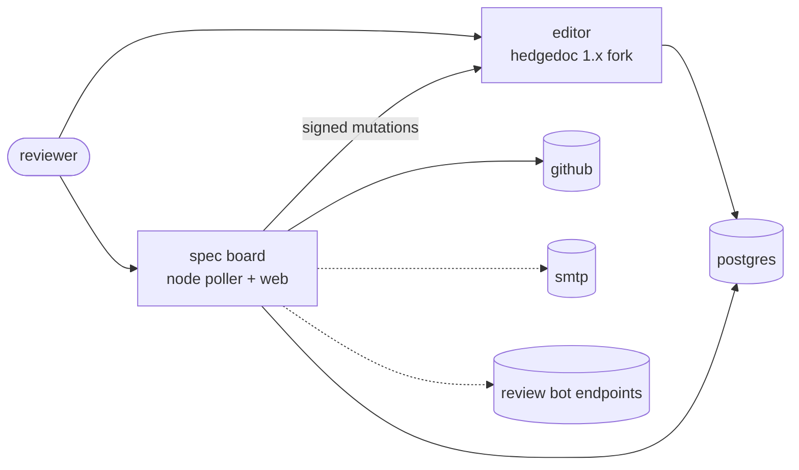

# architecture

two services and one postgres.

## editor

hedgedoc 1.x plus criticmarkup review: inline comment threads, suggestions with
accept/reject, approvals in the navbar, a `/new/spec` template, deep links to
threads. the rebrand is applied at image build time, so the source tree stays
upstream-clean ([releases](release.md)).

| property | value | why it is fixed |
| --- | --- | --- |
| replicas | 1 | hedgedoc 1.x holds note state in process; a second replica diverges |
| rollout | replace, never parallel | same reason |
| uploads | filesystem volume, RWO | `CMD_IMAGE_UPLOAD_TYPE=filesystem` |
| login | github oauth, no `repo` scope; personal tokens for the note API | tokens inherit note permissions and do not grant browser or approval access |

hedgedoc stores each user's oauth token in `Users.accessToken` in plaintext.
that is upstream's design, and the reason the login asks for no repo access.
personal access tokens are separate: only their SHA-256 hashes and management
metadata are stored. users create and revoke them from a session-authenticated
page with CSRF protection. the bearer-only note API runs before browser-session
middleware, so an API request neither creates a session nor gains its privileges.
the CLI's device flow uses the same browser identity and PAT model. grants store
hashed codes, expire after ten minutes, and issue a PAT once under a database
lock. a separate cancellation capability can revoke that PAT after a lost
exchange response.

API updates require the note's current ETag. a per-note reservation excludes
open editors, pending connections and saves until the conditional database
write and any public receipt transaction finish. this relies on the
single-editor-process deployment above.
unchanged text keeps its authorship; API edits enter the normal revision saver.
the save coordinator retains one active snapshot and one latest pending snapshot,
merging participant history. approvals wait for an exact saved-text acknowledgement.
external account keys include the provider; legacy accounts are adopted only when
their stored provider and subject match the login.
keyed author writes commit a compact receipt in the same transaction as the
note. replay checks the current user's permissions before returning a result.

## spec board

one node process: a poll loop and a small web ui. it owns the `spec_board_*`
tables and reads hedgedoc's tables. the editor owns all note mutations.

- finds specs by frontmatter (`tags: [spec, <status>]`), resolves approvers from
  `.specs/roles.yml` in the target repo, opens the spec PR once quorum is met
  and every comment thread is resolved. a spec re-reviewed after that PR merged
  republishes as a revision PR on the same file, keeping its number.
- asks the editor's signed mutation API to lock notes or append bot comments.
  active notes refuse mutations until their editors close. durable permission
  intents and editor receipts recover a lost response without overwriting an
  owner override; the editor preserves human authorship around generated text.
- recovers published text from the PR's merge commit. a per-spec generation
  guards publication state, snapshots and queued events, so a delayed response
  from a previous poller cannot overwrite a newer publication.
- keeps its own copy of a spec's published text at each status change,
  approval and publish (`spec_board_snapshots`); `/changes` diffs those rows
  and they tell an approver the text moved past them. the text is
  already public through `/api/specs`; the rows add only who approved what.
- github access is per project: an app installation token where the app is
  installed, otherwise the service PAT.
- derives a map of the approved and implemented specs from their `depends-on`,
  `supersedes` and area declarations, and publishes it on `/map` and as a
  generated `README.md` riding in each spec pr. a note marked
  `kind: top-level` is a spec every other spec inherits: unnumbered, listed
  first, and fed to the review bot and the checkpoint overlap pass as context.
  a review also carries the spec's declared and same-area neighbours, so a
  contradiction between two feature specs surfaces while both are still cheap
  to change.
- tags a reconciled spec corpus as `specs/vN` on the project's repo when a
  board admin cuts a [checkpoint](spec-checkpoints.md). the annotated tag and
  its message are the whole record; no board table backs it.
- serves the corpus as json at `/api/specs` for tools outside the browser
  ([reading specs elsewhere](api.md)), including a `current` revision hedgedoc's
  own revision list cannot offer.
- resolves a spec reference at `/spec/<owner>/<repo>/<n>`, redirecting to the
  note or, failing that, the pull request. it is the only side that maps a spec
  number to a note, so the editor links through it. the project must be on
  the allowlist, or the route is an open redirector.
- optional: smtp digests, webhook notifications, review bots backed by an
  openai-compatible endpoint.
- implementation feedback runs in the same bounded poll loop. separate
  modules collect github evidence, validate model proposals and queue them;
  the poller writes each one into its note as a suggestion through the same
  editor mutation path the review bots use, and tags an approved spec back
  into review. source hashes and canonical repo blobs identify each analysis.
  shared project toggles pause automation independently of personal settings.
- `mcp/` is a separate, optional process that runs on a developer's or an
  agent's machine, not in the deployment. it adapts the shared `cli/` clients
  and context implementation to the model context protocol within a token budget
  ([context graph for agents](context-graph.md)). its `context` tool selects
  complete spec sections for a task. optional laya ranking runs through a
  configured loopback service; the graph and source text remain deterministic.
- `cli/` provides direct commands for spec reads, author edits, bot reviews
  and code context. HTTP commands load no checkout index. context commands
  index the selected checkout with optional tree-sitter dependencies.
- public bot receipts bind a client key to the exact prepared editor mutation,
  including a persistent internal operation id. retries after a restart reuse
  that mutation instead of rebuilding it from newer text. prepared source is
  cleared after completion, deletion or expiry; seven-day result retention
  leaves non-content tombstones so expired keys cannot execute again.

| property | value | why it is fixed |
| --- | --- | --- |
| replicas | 1 | two pollers can double-open a PR; an advisory lock guards concurrency, not atomicity |
| rollout | replace, never parallel | same reason |
| schema | explicit migration job and checked runtime schema version | restricted runtime performs no DDL and refuses incompatible schemas |
| shutdown | stops admission, cancels reads/models, drains recorded effects; 25s hard exit | remote writes need reconciliation when their result is uncertain |

## trust boundaries

- anyone who can edit a note can change spec text, by design. approval works the
  other way: approvers and quorum come only from the branch-protected target
  repo, never from the note.
- `/api/specs` is unauthenticated too, and serves whole spec bodies and raw
  revisions rather than the first paragraph the board page shows. it reads the
  snapshot after checking current permissions on each request, so it exposes no note hedgedoc would refuse a guest,
  but it makes the corpus collectable in one request.
- the board page is unauthenticated and its search matches note bodies, so it
  only ever lists notes hedgedoc itself shows a guest. a spec note set
  `limited`, `protected` or `private` is dropped from the board and cannot
  publish. moderator-hidden notes are excluded using current database state.
- an approval is the board's own record, not the note's `approved-by` list:
  the editor's button sends a signed GitHub identity, note, action and saved-text
  hash. the board checks the immutable GitHub subject against `roles.yml` and compares the current
  candidate under the same row lock that records its approval snapshot. quorum and the `Reviewed-by`
  trailer both rest on that record, so a name typed into the note by anyone
  neither opens a PR nor earns a trailer. a commenter is credited from
  hedgedoc's per-character authorship, a thread signature their own session
  wrote. branch protection on the target repo remains the control that
  decides what merges.
- the board publishes using project installation tokens or its service token.
  its restricted database role cannot read editor OAuth tokens. a transaction
  records the exact candidate, policy, approving subjects and submission ID
  before GitHub writes; retries consume that immutable intent. edits after the
  authorization point require another candidate. supersession activates only
  after the exact same-project document and metadata are verified as merged.
- review bot api keys live in `spec_board_bots` as authenticated ciphertext,
  bound to the bot identity and encrypted with a key outside PostgreSQL.
  every model consumer uses allowlisted HTTPS, connection-time DNS checks,
  bounded replies and durable request/token budgets.
- published `/s/` views strip every criticmarkup comment, resolved or not.
- the mcp server holds no credential and sends nothing to the board beyond
  the unauthenticated `GET`s above, unless explicitly granted write capability,
  exact note IDs and a bot token. with those,
  it can also write comments and suggestions to the notes in that bot's
  projects, and nothing else ([writing as a bot](context-graph.md#writing-as-a-bot)).
  the board keeps only the token's hash. what it reads from the checkout it hands
  to whichever agent runs it, so it belongs on the machine that already has
  the checkout, not on a shared host. local reads, including nested manifests
  and Git metadata, are confined to explicitly configured real roots.
- reports enter a moderator queue and never automatically hide content.
  stable-ID moderators record reasons for note restrictions and account
  suspensions; reversible decisions remain in an append-only audit trail.
  the editor enforces restrictions on reads, writes, uploads and active sockets.
- with `SPECDOC_LAYA_URL` set, the mcp process sends task text and candidate
  spec excerpts to that loopback service for ranking. the service's operator
  controls its logging and retention. the board does not receive these tasks
  or scores, and the mcp server does not persist them. receipts are supplied
  per call by the agent and suppress only text that the caller still has;
  they do not establish spec status, approval or conformance.

## what a deployment has to provide

- postgres 13+, one database shared by both services
- two hostnames with TLS, one per service
- a read-write-once volume for uploads
- credentials per service ([bootstrap](bootstrap.md))

nothing here requires kubernetes. the reference deployment runs on openshift and
its manifests are public in
[specdoc-infra](https://github.com/pfeifferj/specdoc-infra), including the
constraints that are specific to it: a single node, hand-made hostPath volumes,
and backups on the same disk as the database.
