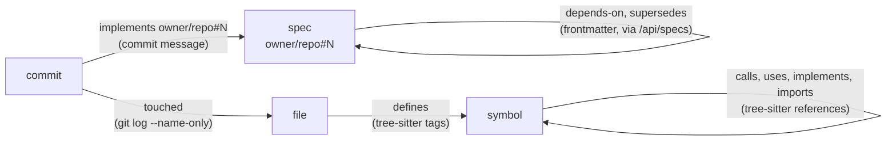

# context graph for agents

The [SpecDoc CLI](cli.md) exposes this context engine through
`specdoc context query`, `brief`, `search`, `neighbors`, `get`, and `trace`.
It also supports remote reads, author edits, bot reviews and browser login.
The MCP adapter retains the tool names and response contracts below; both
interfaces share the implementation shipped in the CLI package.

`mcp/` is a [model context protocol](https://modelcontextprotocol.io) server
that joins the board's specs with the code in a checkout. a coding agent asks
it for the spec sections needed by a task, or one code symbol at a time,
instead of loading the corpus or the tree.

## setup

it runs over stdio in the implementation repo. `.mcp.json` there:

```json
{
  "mcpServers": {
    "specdoc": {
      "command": "node",
      "args": ["/path/to/specdoc/mcp/server.js"],
      "env": { "SPECDOC_URL": "https://specs.example.com" }
    }
  }
}
```

it reads the board's [read api](api.md) and the checkout's working tree and
`git log`. unless it is given a bot token it writes nothing and holds no
credential ([writing as a bot](#writing-as-a-bot)). knobs:
[configuration](configuration.md#specdoc-mcp).

the spec repos it reads are the ones the checkout's `implements owner/repo#N`
commits name, or `SPECDOC_NAMESPACE`. with neither it reads every project
the board serves. an explicit `SPECDOC_NAMESPACE` stays restricted to those
projects even when they contain no specs. projects inferred from the checkout
may fall back to the public corpus when none match. a spec named outright, as
`owner/repo#N` or as a note id, with or without the `spec:` prefix, is read
even when it sits outside that scope, and the reply opens by saying so;
`search`, dependents and `supersedes` stay inside the scope, and a bare `#N`
is read against the scope, so the `spec:` prefix does not widen it either.

## nodes and edges



| node | id | source |
|---|---|---|
| spec | `spec:owner/repo#N`; `spec:<shortid>` for an unnumbered note | `GET /api/specs`: title, status, abstract, `depends-on`, `supersedes`, PR number. body on demand from `GET /api/specs/<id>` |
| commit | `commit:<sha>` | `git log --grep='implements '` in the checkout. only commits naming a spec are nodes |
| file | `file:<path>` | `git ls-files`. any tracked regular file, parsed or not, since a config file or a doc can implement a spec |
| symbol | `sym:<path>#<name>`; `@<line>` when the file defines the name twice | tree-sitter over each parsed file: functions, methods, structs, enums, traits, modules, macros |

| edge | from | to | source |
|---|---|---|---|
| depends on, needed by | spec | spec | `depends-on:` in the frontmatter as the board resolves it. the inverse is computed locally |
| supersedes, superseded by | spec | spec | `supersedes:` in the frontmatter |
| implements | commit | spec | the `implements owner/repo#N` grammar, parsed by `spec-board/refs.js` so board and server agree. a bare `#N` resolves to the origin repo |
| touched | commit | file | the commit's file list |
| defines | file | symbol | the grammar's shipped `tags.scm` |
| references | symbol | symbol | the tags plus `mcp/queries/rust.scm`: calls, scoped paths, type positions, trait impls, imports. a reference inside a definition's body is an edge from that definition |

the chain is `spec -> commits -> files -> symbols`, walkable in both
directions. it is file-level: which symbols a commit changed is not recorded,
only which files. the `ponytail:` note in `mcp/trace.js` names hunk
intersection as the upgrade.

not in the graph: HedgeDoc revisions, comment threads, approvals, and any
note the board hides from guests. the spec side is what `/api/specs` serves.

the server keeps the graph in memory and refreshes it from these sources.
graph construction is deterministic. an optional local laya service can rank
candidate spec sections for `context`; it does not create graph edges or
decide which requirements are authoritative.

## freshness

the index follows the working tree, so uncommitted edits are in it. each
tool call stats the tracked files and re-parses the ones whose modification
time moved. the implements-commits are re-read when `HEAD` moves. the spec
corpus is refetched when the board's `Cache-Control` lapses, which tracks its
poll interval; a board outage keeps the last corpus and says `stale:`. every
response starts with what it reflects and how old the spec side is: the
board's own observation time when it sends one, the time this process last
read the board when it does not (`fetched 3m ago`).

```
index 3f2a9c1+dirty: 212 files, 1840 symbols; specs: 14 (netfyr/specs), board read 3m ago
```

## tools

six read tools. ids are what the tools print.
bare forms are guessed, so `src/dhcp.rs#refresh` and `netfyr/specs#7` work.

| tool | returns |
|---|---|
| `context(task, anchors?, seen?, max_docs?, max_tokens?)` | complete spec sections selected for a task, their provenance, receipts for sections returned in full, and recovery instructions for omissions |
| `brief(max_tokens?)` | the spec index (approved and implemented listed, the rest counted) and the most referenced symbols with signatures, ranked by inbound references with a boost for files in the last twenty commits. about a thousand tokens |
| `search(query, kind?, level?, limit?)` | symbols by name (exact, prefix, substring) then by path fragment; specs by words in title or abstract. `level`: `fold` (one line), `preview` (plus signature or abstract), `full` (plus source) |
| `neighbors(id, direction?)` | one hop. symbol: callers, callees, the specs its file implements. spec: `depends-on`, dependents, `supersedes`, implementing commits and files. file: its symbols and the files that use them. commit: its specs and files |
| `get(id)` | a symbol's source, a file's outline, a spec's published body with its implementing commits, or one section identified by `context` |
| `trace(id)` | spec to commits to files to symbols, or a symbol or file back to the specs its commits name |

every tool takes `max_tokens` (default `SPECDOC_MAX_TOKENS`, 1500; `brief`
defaults to `SPECDOC_BRIEF_TOKENS`, 1000). `context` accepts 500 to 20000.
whole items past the budget are dropped and the reply ends with how many
and which argument narrows the question. a symbol's source or a whole spec's
body is cut line by line instead.
`context` and section retrieval keep sections whole. their budget includes the
header, provenance and omission notices, estimated at four characters per
token. this is an estimate, not a tokenizer count. graph navigation stays
one hop at a time; [decisions](#decisions) has the reason.

## context for a task

call `context` with a short task description and any known spec or section ids
in `anchors`. file, symbol and commit anchors discover specs through their
file-level implementation links; the reply contains spec text. both `anchors`
and `seen` default to empty arrays; `max_docs` defaults to 24 and caps document
read attempts, including failed ones, up to 32. document responses, including
json metadata, have a 256 KiB limit and a combined 2 MiB read allowance.
selection has a ten-second deadline for body reads, after the common metadata
refresh. optional ranking then has its own configured deadline (two seconds
by default). automatic
discovery uses approved or implemented, non-retired specs in the configured
namespaces. when scope is every project because no namespace was configured or
inferred, automatic discovery is disabled; set `SPECDOC_NAMESPACE` or supply
explicit anchors. the same lifecycle filter applies to automatically included
top-level specs and dependencies. a draft, retired or unresolved dependency is
reported as a gap for direct inspection.

explicit spec and section anchors can reach draft, retired or out-of-scope
specs, and the response identifies those cases. top-level specs and dependencies enter
selection independently of any model score. document, size and time limits can
still leave required sources unread; the response reports those omissions.

the server selects complete markdown sections with the introductory text of
their ancestor headings. lists whose items all start with `FR-` or `SC-`
identifiers are split into complete requirements, including nested lists,
examples and continuation paragraphs. surrounding conditions stay attached.
shared ancestor text and document metadata appear once per response, with
source line ranges listed on each section. it returns source text, not generated summaries.
every excerpt identifies its spec and a versioned section id of the form
`section:<encoded-note-id>:<body-hash-prefix>:<number>`, where the hash prefix
is 16 hexadecimal characters and the section number starts at one. copy ids
from the response rather than building them. `get` accepts them when more
space is needed for a section. if the body has changed, the old section id is
rejected; run `context` again to obtain ids for the current text.

the source is the board's **current publishable text**. even an implemented
spec with a merged pr can contain a later, unmerged revision on the board.
use the merged spec file and its git revision for implementation acceptance.
section selection is a reading aid; retrieve omitted requirements and check
the applicable merged top-level specs and dependencies before claiming a
complete conformance review.

`context` and section `get` issue a receipt only for a section returned in full. pass those
receipts in `seen` on a later call only while the corresponding text is still
available in the caller's context. matching receipts suppress duplicate text,
including explicitly anchored text; changed sources are returned again. the
server keeps no session-wide read history. omit `seen` after compaction, for
a new subagent, or whenever the earlier text is no longer available. a receipt
is not evidence that a requirement was satisfied.

sections that do not fit are omitted whole, with instructions to retrieve them
using `get` and a larger budget. section retrieval also returns the whole unit
or reports the budget it requires. inspect document and section omission notices:
a response that fits the budget can still leave requirements unread.

### optional laya ranking

without extra configuration, `context` ranks candidate sections by the task's
words. exact section anchors come first, followed by explicit spec anchors.
within those groups, requirements with matching text precede other sections;
matches in a document title or shared introduction alone have lower priority.
dependencies remain protected from model ranking, but their unrelated text
does not take priority over matching requirements. omissions remain visible
as required gaps. lexical matching can miss implicit constraints and synonyms;
known spec anchors help narrow the search, and this is not a recall guarantee.

setting `SPECDOC_LAYA_URL` enables a local laya service behind this same
tool. it reranks optional sections within those priority groups; it does not
discover sections missed by that selection. the mcp server sends the task and
candidate spec excerpts to the service's `/v1/systemone/batch` endpoint.
only the selected sections reach the
coding agent, so the candidate set does not fill its context window.

a request scores at most 16 complete sections of at most 6000 characters each.
`SPECDOC_LAYA_MAX_CANDIDATES` and `SPECDOC_LAYA_BATCH_SIZE` can reduce the
workload; `SPECDOC_LAYA_TIMEOUT_MS` can raise the ranking deadline up to 60000
milliseconds for an explicit cpu test. successful scoring reports elapsed time,
and a timeout reports its budget and attempted workload. a loaded model's health
check does not measure inference latency. changing batch size requires measuring
the result; smaller batches are not always faster.
longer sections retain their lexical order, and tasks over 2000 characters
bypass laya. the model input limit is 512 tokens; if laya reports truncation
or does not confirm completeness, the batch keeps its lexical order. source
sections are never shortened to obtain a model score.

the url must use http or https on a loopback host. the service may be shared
by local mcp processes; its logging and retention are controlled by its
operator. specdoc does not store the task or scores. explicit spec and section
anchors, top-level specs and dependencies bypass model ranking. a failed,
timed-out, invalid or truncated model response falls back to word matching. ranking does
not change source text, approval status or implementation provenance. see
[configuration](configuration.md#specdoc-mcp) for model and timeout settings.

## writing as a bot

a model running beside the agent, on the same machine, can review specs
under a bot's name. a board admin creates the bot at `/bots`, leaving
endpoint and model blank for one that only writes this way, and issues it a
token. the token is shown once and the board keeps only its hash. set it as
`SPECDOC_BOT_TOKEN` in the server's env and four more tools appear:

| tool | does |
|---|---|
| `read_note(id)` | the raw note with its criticmarkup, the open threads with their ids, and `expected_hash` |
| `comment(id, expected_hash, comments)` | `{ quote?, text }` each, placed after the first occurrence of `quote` or appended at the end |
| `suggest_edit(id, expected_hash, edits)` | `{ quote, replacement, rationale }` each, written as `{~~quote~>replacement~~}` with the rationale as a thread beside it |
| `reply(id, expected_hash, thread, text)` | one more comment on an open thread |

`id` is anything `search` prints for a spec, or a note id. every write sends
the `expected_hash` of the note it read. if the note has changed since then,
or the editor has it open mid-edit, the write is refused and the model reads
it again. edits are always suggestions, so a person accepts or rejects each
one and approval works as it does for human reviewers. a bot's text is never
credited as review or approval. comments and replies go only on specs in
draft or review. a suggestion on an approved spec moves it back to review,
the same as an [implementation feedback](configuration.md#implementation-feedback)
proposal. the token reaches only public notes in the bot's projects.

## a session

implementing spec 7 in a checkout of `netfyr/netfyr`:

1. `context` with the task and `anchors: ["spec:netfyr/specs#7"]` for the
   relevant spec sections. use `brief` when an overview of the code is needed.
2. recover omitted sections with `get` and compare requirements with the
   merged spec. `trace spec:netfyr/specs#7` shows existing implementation links.
3. `search dhcp`, then `neighbors sym:src/dhcp.rs#refresh` for callers,
   callees and the specs its file answers to.
4. edit; the next call sees the edit without a restart.
5. before committing, `trace file:src/dhcp.rs` shows which specs the file's
   history names, so the `implements netfyr/specs#7` trailer lands on the
   right commit and the change stays within that spec.

for a bug: `trace` on the file or symbol in the stack, `get` on the spec it
names, `neighbors` on that spec.

## without mcp

every read tool also runs from the shell, for an agent with no MCP client
configured. the first positional is the task, query or id; the other arguments
are flags with `-` for `_`. repeat `--anchors` or `--seen` for each value:

```sh
node /path/to/specdoc/mcp/server.js context 'renew a lease before expiry' --anchors spec:netfyr/specs#7
node /path/to/specdoc/mcp/server.js search dhcp --kind symbol
node /path/to/specdoc/mcp/server.js get spec:netfyr/specs#7 --max-tokens 4000
node /path/to/specdoc/mcp/server.js trace file:src/dhcp.rs
node /path/to/specdoc/mcp/server.js brief --out .specdoc/brief.md
```

the output is what the tool returns over MCP. an unknown id exits non-zero.
`--out` writes it to a file instead, so a `CLAUDE.md` can include the brief
with `@.specdoc/brief.md`. that file goes stale like any generated file;
regenerate it from a git hook. the write tools stay MCP-only. the spec side
alone is the [read api](api.md).

## languages

rust today. another language is its tree-sitter grammar package added to
`LANGS` in `mcp/index.js`, plus a `mcp/queries/<language>.scm` for what its
shipped `tags.scm` leaves out. for rust that file adds scoped calls, type
positions, trait method signatures and imports, which carry most cross-file
edges. symbol kinds are the grammar's node types minus their suffix; a new
grammar may need a case in `kindOf`.

## limits

- symbols match by name across the repo. a name defined in several places
  lists every candidate; the exact id carries `@<line>`.
- trace is file-level.
- `brief` ranks by reference count, not pagerank. the `ponytail:` note in
  `mcp/index.js` names the upgrade.
- `search` is by name, path, and words in a spec's title or abstract.
  `context` ranks bounded spec sections, optionally with laya; it does not
  index a persistent embedding corpus.
- context receipts reduce repeated text only when the caller supplies them.
  omitted sections and the document cap can leave requirements unread.
- one server per checkout and one board per server.

## decisions

these measurements informed the graph's design. task context adds bounded
section selection; optional ranking should be evaluated on the task's useful
context and token cost.

| decision | evidence |
|---|---|
| local process, not hosted | repograph, locagent and codexgraph all build from the checkout the agent edits, and none describes incremental updates. hosting would add a checkout, a volume and a lag to the board for no measured gain |
| one hop, budgeted | [repograph](https://proceedings.iclr.cc/paper_files/paper/2025/file/4a4a3c197deac042461c677219efd36c-Paper-Conference.pdf) table 4 (iclr 2025): a 1-hop neighbourhood of 2.3k tokens raised swe-bench lite resolve rate, a flattened 2-hop one of 10.5k tokens dropped it below no graph. codexgraph table 2 (naacl 2025): uncontrolled query output cost 22k to 102k tokens per task against 1.5k to 15k for plain retrieval |
| typed tools, no MCP resources or query language | codexgraph's agent writes cypher through a translation model; without that layer its accuracy fell below the no-graph baseline. locagent's three typed tools with fold, preview and full detail are the model followed here |
| tree-sitter tags, no model-built graph | specs and commits are already structured. graphiti and cognee extract with a model per episode, so build cost scales with model throughput; their issue trackers are rate-limit reports. a regex extractor was tried and rejected: rust impl and method scoping breaks it |
| name search and an in-memory graph | direct lookup and graph navigation stay deterministic. task context adds section packing and optional laya ranking without maintaining a second record of the specs |
