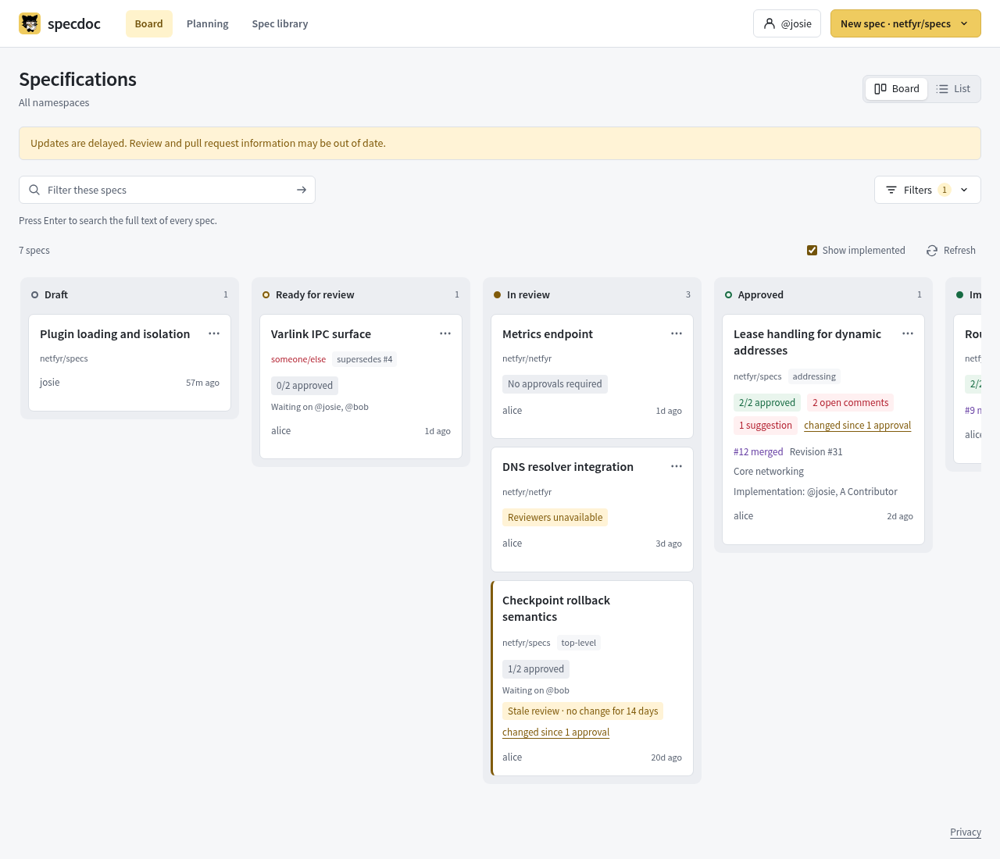

# onboarding a project

a project is a github repo that receives approved specs as PRs. every spec
belongs to exactly one, via `namespace: owner/repo` frontmatter or the board's
default. only repos on the operator-controlled allowlist take part in the PR
flow; specs pointing anywhere else get a red chip with the repo name, titled
"Unknown project, PR flow disabled", and never open PRs.



## prerequisites

- a github repo to hold the specs. features can live in other repos (see
  `implementation-repos` below).
- the board's service token (`GITHUB_TOKEN`) needs contents read/write and
  pull requests read/write on the repo.
- spec authors have write access on the repo and log in to the editor via
  github. login asks for no repo permissions, so spec PRs open under the
  board's service token rather than the author.

## steps

1. commit `.specs/roles.yml` to the repo's default branch:

   ```yaml
   approvers:                          # immutable GitHub IDs; login is a display label
     - {id: "12345", login: reviewer}
     - {id: "67890", login: maintainer}
   authors: ["24680"]                  # more admitted authors; approvers can author too
   approvals-required: 2               # default 1; 0 publishes without approvals
   implementation-repos: [owner/app]   # scanned for "implements #N"; default: this repo
   # feedback-bot: reviewer           # optional: bot name configured on /bots
   commit-prefix: spec                 # PR/commit type; "" for a bare title
   areas: [api, design, client]        # optional allowlist; also enables tag routing
   specs-dir: specs                    # dir specs land in; "." for the repo apex
   ```

   a spec picks its area with `area: api` in the note frontmatter and lands
   as `specs/<area>/NNN-<slug>.md` (`specs/NNN-<slug>.md` without one). any
   area routes by default; declare `areas` to restrict the set and to let a
   matching note tag route as fallback.

2. protect the default branch against deletion and force pushes. require the
   repository checks that validate published specs. projects using GitHub
   review can also require CODEOWNERS approval for `specs/**` (`*` in repo
   mode). projects that finish their review in SpecDoc can enable
   [automatic publication](#automatic-publication).

3. add the repo to the board's `NAMESPACES` env (comma-separated) and roll
   the deployment. to make it the default for specs with no `namespace:`, also
   set `DEFAULT_NAMESPACE` on the board and `CMD_SPEC_DEFAULT_NAMESPACE` on
   the editor; the two must match.

4. verify with `curl https://<board-host>/api/namespaces`: `repo`, `push`,
   and `roles` should be `pass` (`protection` stays `unknown` when the token
   can't read branch protection, which is fine), `poller.stale` should be
   `false`.

## roles.yml semantics

- approvers and authors are numeric GitHub account IDs; a login is only a
  display label. a note publishes, gets bot review and sends notifications only
  when the GitHub account that owns it in the editor is in one of the lists;
  the note's `owner` and `approved-by` fields grant nothing. a missing or
  invalid `roles.yml` stops all of that for the project.
- `approvals-required` is an integer from 0 to the number of approvers; any
  other value makes the file invalid. `0` removes only the approval count;
  every other publication check still applies. a change to a spec's text or
  relations, or to this file, stops earlier approvals counting
  ([what changed](spec-lifecycle.md#what-changed)).
- unresolved comment threads block approval regardless of quorum.
- `areas` (legacy key: `categories`): optional. without it, any `area:`
  frontmatter routes as its slug and tags never route. with it, an unlisted
  area is ignored and the first note tag matching the list is the fallback.
  spec numbering (`NNN`) is per directory, and the area is pinned when the
  PR opens, so later frontmatter or tag edits never re-path an existing PR.
  two notes that share a title get separate numbers, and a retry finds its PR
  by submission ID and verifies its path and document.
- `implementation-repos`: repos scanned for `implements` commits. omit when
  features land in the spec repo itself.
- `feedback-bot`: optional existing bot name, enabled and assigned to this
  project on `/bots`. enables amendment proposals after implementation PRs
  merge. the source repos and target specs must be public; implementation-repo
  credentials need issues and pull requests read access, plus contents read
  access in the canonical spec repo. put
  `implements owner/spec-repo#N` in implementation PR descriptions. project
  approvers and board admins can pause automation from settings without editing
  this file. ordinary spec review continues when feedback is paused.
- `auto-merge`: optional merge method and required check names with GitHub App
  IDs. omitted or `false` leaves merging to the repository's normal process.
  see [automatic publication](#automatic-publication).
- `specs-dir`: where specs land. `.` (or `""`) publishes at the repo apex:
  `<area>/NNN-<slug>.md`, no `specs/` dir. any other value is a subdir,
  nesting allowed (`docs/specs`). changing it orphans already-published
  specs: they stay where they are, and numbering starts over in the new dir.
  a subdir also gets a generated `README.md` [spec map](spec-lifecycle.md#the-map);
  the apex layout does not, since that file is the project's own.

## automatic publication

To let SpecDoc merge publication PRs after editor review, add this to the
project's protected `roles.yml`:

```yaml
auto-merge:
  method: merge
  checks:
    - name: validate
      app-id: 15368
```

Use the actual check name and App ID reported by your repository. The example
expects a GitHub Actions check named `validate`. `method` accepts `merge`,
`squash` or `rebase`; the repository must allow the chosen method. At least
one check is required. Configure the same checks in branch protection, with
the expected App and an up-to-date branch requirement. Give the publication
App checks read access as well as contents and pull requests write access.

SpecDoc requires those checks to finish successfully on the PR's exact head.
A missing, pending, skipped or failed check leaves the PR open. Before merging,
the board reads the current note, approval receipts and project policy again.
The candidate must still be approved, admitted, public and free of unresolved
discussion. Changing `roles.yml`, including this setting, requires fresh
approvals.

Only PRs linked to a recorded SpecDoc submission qualify. The branch must
contain the authorized specification and any recorded map or supersession
update, with matching contents and no other file changes. When the base branch
advances without changing those files, SpecDoc updates the publication branch
and waits for its new checks. A changed PR head or destination stops that merge
attempt. SpecDoc does not reopen a closed PR. A changed initial candidate with
fresh approval replaces the pending PR with a new submission; once published,
the spec keeps its original identity. Repository protections still apply;
configure GitHub review requirements according to
whether the project needs a second review there.

This setting does not merge configuration changes, checkpoint requests or
standalone map updates. Those follow the repository's normal review process.

## repo mode

a repo that holds nothing but specs can commit `roles.yml` at the repo root
instead of `.specs/roles.yml`. that flips the `specs-dir` default to the
apex; set `specs-dir` explicitly to override in either direction. with the
apex layout, point CODEOWNERS at `*` instead of `specs/**`.
