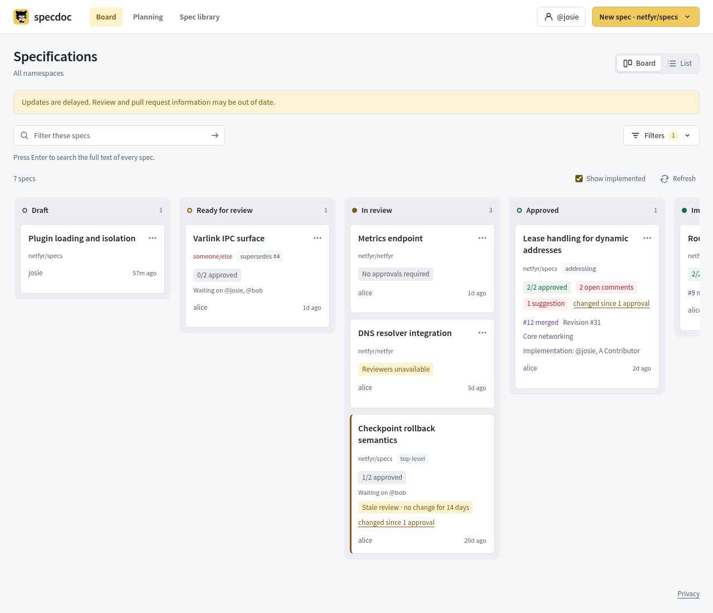
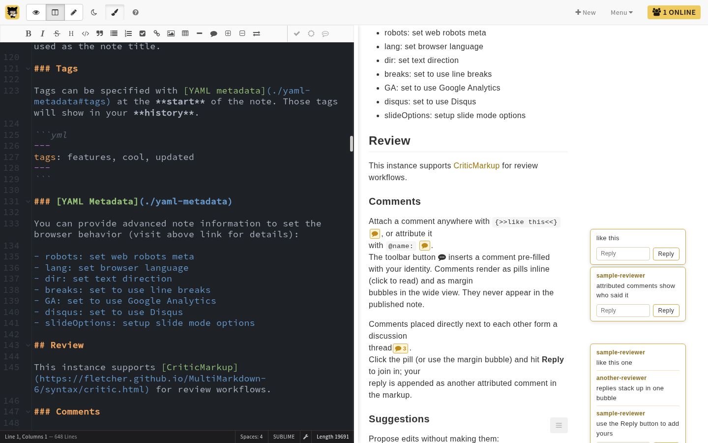
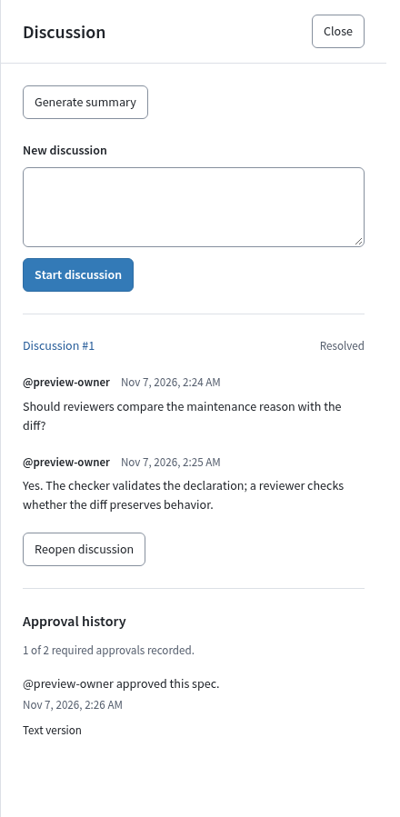
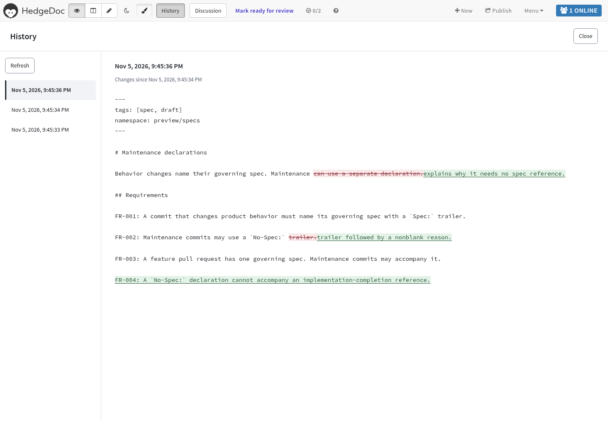

# spec lifecycle

a note is a spec when its frontmatter tags include `spec` plus a status tag.
the most advanced status tag wins; no status tag means draft.

```yaml
---
title: Realtime presence cursors
tags: [spec, draft]
owner: octocat
namespace: owner/repo
---
```

`namespace:` is the key an author types; the board's pages call the thing it
names a project.

## creating a spec

the board's "new spec" button (with a project picker when more than one
repo is onboarded) offers the two kinds, each with a line on what it is for,
and opens the editor with that kind's template: `spec` and `draft` tags set,
`owner` prefilled with your github login, `namespace` from the picker or the
default. the second kind is a [top-level spec](#top-level-specs).

## statuses

| status | meaning | how it's reached |
|---|---|---|
| `draft` | being written | default for any spec note |
| `ready-for-review` | author considers it reviewable | "mark ready for review" in the editor navbar, or edit the tag |
| `in-review` | review underway | automatic once the first comment thread appears (computed by the board; resolving every thread reverts it), or "start review" |
| `approved` | approval quorum met; publication checks still apply | the approval that meets quorum sets the tag |
| `implemented` | implementing commit merged | an `implements` commit is detected; the card leaves the board |

cards in the review columns get a stale marker after `STALE_DAYS` (default
14) without changes.



## review

reviewers work inside the note with criticmarkup; the toolbar covers all of
it, nobody needs to learn the syntax:



- comments: `{>>@name: text<<}`, shown as margin bubbles and inline pills.
  adjacent comments form a thread; the reply box appends to it.
  opened cards can overlap the editor in split view, keeping their reply and
  resolve controls reachable.
- the comment and suggestion tools refuse positions in the yaml header,
  including before its opening `---`; place reviews in the body below it.
  an editor upgrade also repairs existing specs with comments before the
  opening delimiter, moving those comments below the header with their
  attribution intact.
  the board also recognizes these specs before the stored note is repaired;
  their open comments still block publication.
- suggestions: insert, delete, and replace spans with accept/reject buttons.
  a pending one blocks publication because the PR uses its accepted wording.
  accept or reject the edit before publishing; removing the markup clears the
  gate. highlights are not edits and never block.
- resolving a thread means accepting or deleting its markup, or the bubble's
  resolve button. unresolved threads show on the card and block publication.
  resolved ones stay in the note and read back through "show resolved" in the
  toc menu; reopening one means deleting its `{>>%%resolved%%<<}` marker in
  the editor pane.
- each thread has a deep link: the bubble's copy-link button yields
  `<note-url>#comment-<hash>`, which on load scrolls to and highlights that
  thread. the hash is derived from the first message's author and text, so a
  link survives edits elsewhere in the note but breaks if that message's text
  changes. bot review notifications link straight to the thread the bot added.

The editor's Discussion panel holds conversations about the whole spec outside
its Markdown. Signed-in GitHub users can start threads on editable specs and
reply to open threads. Once a spec is locked or approved, only its owner,
project approvers and board admins can add or reopen threads. Those accounts
can also resolve any thread. A thread starter can resolve their own thread and,
while the spec remains editable, reopen it if they were the one who resolved it.
An open general discussion blocks publication. Reviewers can record approvals
while discussions remain open; resolve them before publishing.



approvers from the project's `.specs/roles.yml` get an approvals dropdown
in the navbar: the full roster with each approver's state. approve shows
while the spec is `ready-for-review` or `in-review`. clicking saves the exact
text being reviewed, then asks the board to verify that version and record
the approval. once the board confirms, the editor adds the name to the note's
`approved-by` list. the roster reads the board's record, so a name typed into the list
by hand shows as pending and is not counted until its owner approves from the
navbar. retract works the same way in reverse.

a [review bot](configuration.md#settings-page-and-review-bots) reads the
project's approved [top-level specs](#top-level-specs) alongside the spec it
reviews and flags a contradiction by principle ID. it also reads up to three
approved specs the spec under review depends on, that depend on it, or that
share its area, and flags a statement that cannot hold at the same time as one
of them. that finding is advisory: it shows on the board card as "N possible
conflicts" and never blocks approval, because a call about a second document
nobody is editing is not certain enough to hold a spec up. a contradiction
inside the spec itself is an ordinary review comment and blocks like one.

Declaring a relation does not suppress a conflict finding. Read the cited text
to decide whether the change is intentional and whether the replacement leaves
any requirements uncovered.

a `supersedes` or `depends-on` the board cannot use (malformed, commented out,
pointing at the spec itself, repeated, or a `supersedes` in another project)
shows on the board card and as `relationIssues` in [`/api/specs`](api.md).
until it is fixed the spec does not publish, so it cannot retire the spec it
replaces. blank template fields, lists, comma-separated references and numbers
are valid. frontmatter that does not parse as yaml, or exceeds 8 KiB, leaves the
board unable to read the `spec` tag, so the note drops off the board instead of
showing an issue.

## what changed

Open **History** in the editor to browse saved revisions. Select a revision to
see its source Markdown and the changes since the preceding revision.



For a comparison tied to an approval, status change or publication, use the
board's `/changes/<note>` page. These review snapshots show word changes and
changes to requirement IDs, with frontmatter removed and inline review markup
resolved. Its `from` and `to` parameters accept a snapshot ID,
`approval:<login>`, `status:<phase>`, `published:rN` or `current`.

In **Discussion**, **Generate summary** creates a short explanation
from the current text, confirmed publication baseline and discussion. A reason
appears only when it is recorded in those sources. The summary refreshes when
you request it; changing the text or discussion makes the cached version stale.

Generated summaries can miss or misread a change. Check the diff and discussion
before acting on one. They do not approve a spec or resolve a thread.

Discussion and summary permissions use cached project policy. New access can
take up to five minutes to appear. Approval and publication reload the policy
before accepting a decision.

an approval counts only for the candidate it was given on: the body with its
review markup, title, owner, project, area, kind, relations and visibility,
plus the project's `roles.yml`. status tags are not part of the candidate, so
the move to `approved` keeps every approval; any other change, even resolving a
thread, stops earlier approvals counting toward quorum. the board lists those
approvers on the card ("changed since N approvals") and in the editor's roster
("approved, changed since"), and mails each of them once per new candidate with
a link to the diff from their own approval. approving again from the navbar
counts the new candidate.

a spec that leaves `approved` or `implemented` for an earlier status (by hand,
or because a bot suggestion or feedback proposal landed) loses the approvals
from that round on the next poll, so it needs quorum again before it
publishes. the snapshot taken when it was approved stays as the diff baseline.

## what approval triggers

once the `approved` tag is set, quorum is met, and no inline or general thread
or suggestion remains open,
the board starts this work on its next poll:

- locks the note via hedgedoc's `locked` permission: everyone reads, only
  the owner edits. one-shot; an owner who deliberately unlocks later isn't
  re-locked. the editor defers the lock while anyone has the note open; close
  those tabs to let it finish. reopening a review similarly defers the unlock.
- opens the spec PR: `<specs-dir>/NNN-slug.md` (or
  `<specs-dir>/<area>/NNN-slug.md` when the note declares an area;
  `<specs-dir>/<slug>.md` for a top-level spec),
  criticmarkup resolved to its accepted form, frontmatter stripped, first
  paragraph as the PR abstract. the board opens it with its own service token.
- the PR number becomes the spec's reference number.

If the approved text or project policy changes before that PR merges, the new
candidate needs fresh approval. SpecDoc then closes the verified pending PR
and opens a replacement, keeping both submissions in its history. If the old
PR merges during that handoff, its number remains the spec's identity and the
new text follows the revision process below.

the spec commit carries gerrit-style trailers, so `git log` records the
review in the target repo:

```
spec: add 013 New approach

Spec-Id: rBk2DfsJR52onFFi8X5u-A
Spec-Submission: <submission id>
Spec-Candidate: <candidate hash>
Reviewed-on: https://<editor-host>/rBk2DfsJR52onFFi8X5u-A
Reviewed-by: Alice A <alice@example.org>
Reviewed-by: Bob B <bob@example.org>
Reviewed-by: Carol C <carol@example.org>
```

`Spec-Id` is the note's stable id, `Spec-Submission` and `Spec-Candidate` name
the authorized submission and its candidate, `Reviewed-on` links back to the
note, and `Reviewed-by` is emitted per approver who signed off, then per person
who commented on the note. a `Supersedes:` trailer is added when the spec
replaces another.

reviewer credits use the display name and commit-author email selected in
settings, falling back to the account's primary verified email. notification
delivery addresses are separate. GitHub sign-in requests `user:email` and
saves verified addresses even when the public profile email is private.
publication waits if an author or credited reviewer has no email. older
accounts can refresh their address by signing in again through the editor
or board; the board reports the missing name and the sign-in link in its
publication error.

an approval is a record on the board, made when an approver presses the
navbar button. the editor signs the GitHub identity, note, action and exact
saved-text hash (with the secret the two services share,
[configuration](configuration.md)). the board checks the GitHub account ID
against `roles.yml` and records the snapshot only if the saved text still
matches. an edit during the request asks the reviewer to retry. nothing in the
note itself counts: `approved-by` is written by the editor after the board has
answered, and a name put there by any other means is shown as pending and never
earns quorum or a trailer.

just before opening the PR, the board locks the note, rechecks quorum, threads,
relations, admission and visibility, and records an immutable submission of the
exact text. an edit or retraction after that cannot change what the PR carries.

a commenter is credited on the same evidence: at least one `{>>@name: ...<<}`
signature carrying their display name was written by their own session,
replies and resolved threads included. the spec author is never their own reviewer,
and a guest or a review bot has no account to credit.

an `approved` tag without quorum, with open threads, or with pending
suggestions gets the PR withheld (logged by the poller, and the card says
which). so does a missing or invalid `roles.yml`, a note that is not public, an
owner not listed in `roles.yml`, an invalid relation, or moderation (a hidden
note or a suspended owner). the tag alone never publishes.

## implemented

the spec completes when a commit referencing it merges to the default branch
of one of the project's implementation repos:

```
feat: presence cursors

implements #12
```

a bare `#12` resolves against the repo being scanned, so it only works for code
living in the spec repo itself. from anywhere else write
`implements owner/spec-repo#12`. the board marks
the spec implemented, sends a notification, and drops the card while keeping
its state. a top-level spec never becomes implemented; a reference to its PR
is ignored.

## revising a merged spec

a change that keeps the spec's identity, like a correction the implementation
forced, is edited in place rather than replaced. approval locks the note, so
the owner unlocks it or makes the edit themselves:

1. drop the `approved` tag back to `in-review` (the automatic bump only fires
   from `ready-for-review`, so an approved note stays put until the tag moves).
2. review and adapt as usual; the `approved-by` list and the threads work the
   same way.
3. approve again. quorum and open threads are re-checked from scratch.

the board then opens a revision PR against the same spec file, on a branch
identified by the revision and authorized submission, with the
commit `<prefix>update NNN Title` and fresh `Reviewed-by` trailers. the card
links it as `rev #<pr>` next to the original.

the tag round trip is required: an edit stops every approval counting, and
approving needs a review status. only a project with `approvals-required: 0`
skips it; there any edit with no open threads or suggestions publishes a
revision. Projects can enable [automatic publication](onboarding.md#automatic-publication)
after their required checks pass; otherwise the repository's merge process applies.
when the board holds the previous published text (every publish since it
started keeping them), the revision PR opens with the requirement ids that
changed since it and a link to the board's diff of the two, so a reviewer
decides from the first line whether to open the file diff.

the original PR number stays the spec's number: `implements` and `supersedes`
refs keep pointing at it, and a title edit never re-paths the file. Further
approved edits create a new submission; they do not overwrite the text that an
earlier submission authorized. The next edit after a revision merges or closes
starts the next revision. re-approving without
touching the content publishes nothing, and neither does editing the
`namespace` frontmatter, which stays pinned to the repo the spec published to.

a spec that merged before the board tracked revisions has no record of what it
published, so the first poll that sees it approved treats the note as it stands
as the published text. only edits after that count as a revision.

## learning from implementation review

a project can select a feedback bot in its protected review configuration
([onboarding](onboarding.md)). when a linked implementation PR merges, the
board collects its review discussion and relevant final code changes and asks
the bot which lessons belong in the spec. the PR description must contain
`implements owner/spec-repo#12`; a bare `implements #12` refers to the
implementation repo itself. followup PRs can reference an already implemented
spec. generated spec PRs are excluded.

each proposal lands in the note itself, once the note has been quiet for
`REVIEW_IDLE_MINUTES` and nobody has it open: the current wording becomes a
suggestion carrying the proposed wording, with a comment thread under the
bot's name giving the reasoning and the pull request it came from. accept or
reject it in the editor like any other suggestion. wording the live note no
longer contains arrives as a comment thread alone.

an approved or implemented spec goes back to `in-review` when a proposal
lands, so the suggestion has to be settled and the spec re-approved before
it publishes again; the ordinary revision flow takes it from there. a code
mistake that violates a clear requirement needs no amendment. a reusable
lesson can instead propose a change to an existing top-level spec; once
adopted, subsequent ordinary reviews inherit the improved principle.

under **settings → spec amendments from code review**, a project approver
or board admin can toggle **automatic spec amendment proposals** off for that
project. this pauses collection, generation and placement; suggestions
already in notes stay where they are. turning automation back on resumes the
rolling discovery window.

## superseding a spec

when a spec needs replacing rather than editing, start a replacement: any
card with a PR carries a `replace` link (`show implemented` reveals shipped
specs so those are replaceable too). it opens a new spec in the same
project with `supersedes` prefilled:

```yaml
supersedes: 12          # a spec number in this project
# supersedes: "#12"    # equivalent same-project reference
```

use a bare number or a quoted `"#12"`: yaml reads an unquoted leading `#` as a
comment, so `supersedes: #12` declares nothing, and the board reports it as a
relation error. `supersedes` must name a spec in the same project; an
`owner/repo#12` naming another project is also a relation error, and either
error blocks publication. the note ID of a spec in another project publishes
but retires nothing.

the replacement is an ordinary spec and goes through its own review. the old
spec stays the implementation baseline until the replacement's PR merges, so
closing that PR changes nothing. when `supersedes` is a same-repo number and
the old spec's file exists, the PR also adds a "Superseded by" banner to that
file. after the merge, once the board has verified the merged file, path and PR
against its submission, the old spec leaves the board and the map; its record
is kept. retirement uses the relation in that submission, never the note's live
frontmatter.

an admin can reverse a retirement with a recorded reason
([spec change process](spec-change-process.md#when-a-replacement-takes-effect));
that submission never retires the spec again. a retirement recorded before the
board kept merge receipts no longer hides the spec.

a spec left depending on one that has been superseded is not caught here; it
surfaces when a [checkpoint](spec-checkpoints.md) is cut.

## top-level specs

some documents are not features but constraints every feature inherits: a
design philosophy, a testing approach, naming conventions. frontmatter
`kind: top-level` marks one:

```yaml
---
title: Philosophy
tags: [spec, draft]
kind: top-level
owner: octocat
namespace: owner/repo
---
```

it goes through the same review and approval as a feature spec, with these
differences:

- no number and no area: it publishes at `<specs-dir>/<slug>.md`, the slug
  taken from the title (`Philosophy` becomes `philosophy.md`). the path is
  pinned when the PR opens, so a later title edit does not move the file.
- cited by name and by the IDs it defines (`P4`), never by number. a feature
  spec does not need to declare `depends-on` a top-level spec: inheritance is
  implicit, and declaring it hides no contradiction finding.
- a spec that contradicts one of its principles has to say so in prose and
  argue the case. the review bot reads the project's approved top-level specs
  with every review and flags a contradiction by ID; the checkpoint overlap
  pass does the same across the corpus. a top-level spec is never sent as a
  peer, so it is never in the corpus twice.
- its lifecycle ends at `approved`. changes ride the revision flow like any
  merged spec. retire a principle by saying so under its ID rather than
  deleting it, so citations keep resolving.
- the map lists top-level specs first, in their own section.

## the map

`depends-on` records what a spec builds on. it takes the same reference forms
as `supersedes`, but a list of them:

```yaml
depends-on: [12, 7]           # spec numbers in this project
# depends-on: [owner/repo#12] # or in another project
```

the same yaml gotcha applies, so prefer bare numbers. a reference that matches
no tracked spec is drawn and marked unknown.

from `depends-on`, `supersedes` and the area each spec declares, the board
derives a map of the approved and implemented specs. it appears in two places.

- the board's **Spec library** link, grouped by project and area, top-level specs
  first, with each spec's first paragraph, what it depends on, and what depends
  on it.
- `README.md` in the project's specs dir, as a mermaid diagram plus a table.
  github renders it when anyone browses the directory. it lists only specs
  that have a number, since those are the ones with a file in the repo. a project
  that publishes at the repo apex gets no `README.md`: that file is the
  project's own, so `specs-dir: .` in `roles.yml` opts out.

With auto-merge configured, spec PRs omit the shared README so independent
publications do not conflict over it. Administrators update the repository map
with **Open map refresh PR** on the project's checkpoint page. The board's map
continues to update on each poll.

Without auto-merge, the repository map is included in spec PRs. It refreshes
when a spec is published; implementation updates wait for the next publication
or map refresh.

cutting a [checkpoint](spec-checkpoints.md) refuses on a stale copy, and offers
a pull request that regenerates it.

## the rendered view

hedgedoc hides frontmatter from the rendered half, so the editor renders a
header above the document: title, phase, spec number, owner, the `namespace`
and `area` values, and the `supersedes` / `depends-on` targets as links. the
frontmatter carries it until the board answers, which is what supplies the
number, the phase once an `implements` commit has moved it, and the area the
spec actually files under. a declared area the project does not route to is
struck through: that spec publishes with no area subdir.

references to other specs in the prose are linked too, in the two spellings the
board already parses:

```
see #12 for the routing model          a spec in this note's project
see team/specs#12 for the details      a spec in another one
```

a link goes to `<spec board>/spec/<owner>/<repo>/<n>`, which redirects to the
reviewable note when the board tracks that spec and to its pull request
otherwise. this needs `CMD_SPEC_BOARD_URL` set on the editor; without it
references stay plain text.

what is not linked: anything in code spans or fenced code, since a number in a
command is not a reference; anything inside a heading, because
heading ids are derived from their rendered html and linking there would move
every anchor; and `#12ab34` or `##12`, which are not references.

the published `/s/` view carries the prose links but no header: the server
strips the frontmatter before that page renders.

## notifications

with a webhook configured, the board posts on: status moves, new comments
during review, approvals, the post-approval lock, PR opened, revision PR
opened, supersede, and implementation.

email digests group activity by spec. review starts, discussion updates and
changes since your approval appear in the subject; changes since your approval
come first in the body with a link to the comparison. each spec explains whether
you received it because you participate, watch the project, or approved earlier
text. times are when the board recorded an update, in UTC.

discussion updates include short comment or reply excerpts and links to the
thread. a name is attributed only when the editor's character ownership covers
the whole message and matches the account profile; otherwise the digest says
**Signed @name**. status changes have no invented actor. thread links depend on
the first message's text, so the digest also keeps an ordinary spec link.

General discussion notifications name the signed-in account that performed the
action and link to the thread. The board stores these messages and their activity
separately from the note. Email is queued after the discussion is saved; if
queueing fails, the discussion remains available in the editor but no email is
sent for that update.

For inline comments, the board compares message fingerprints between polls,
including resolved threads. Moving, resolving or reopening unchanged text does
not repeat its notification. Replies and edits are described as **Discussion
updated** because inline messages have no permanent IDs; activity created and
removed between polls is not recoverable. The first poll after an upgrade seeds
existing discussions without replaying them. Previews are capped at 20 per spec per poll and 280
characters each, and the digest body is bounded with an omitted-activity count.

While a review awaits quorum, the board can email the remaining approvers after
`REVIEW_REMINDER_HOURS` (24 by default; `0` disables reminders). The wait starts
when the board first observes that version with no unresolved inline comments,
suggestions or general discussions. It queues one reminder per pending reviewer
and version. A changed text or review policy starts a new wait. Blockers defer
delivery while the queued reminder remains within the mail retention window.
Reminder records are removed when their note is deleted or their review version
has not been observed for 90 days. The current version retains its reminder
record so it does not repeatedly notify the same reviewer.

Reminders honor Disabled notifications, global opt-out and notification address
preferences. Before delivery, the board checks that the note is still public,
the review still needs that person's approval, and their preferences still allow
the message. If the review policy is unavailable, the reminder waits for a
retry while unrelated mail can continue. Policy checks retry hourly without
using up mail delivery attempts. Queued mail expires after seven days or nine
configured digest intervals, whichever is longer, or after 20 failed sends.
An expired reminder is not queued again for the same review version.

polled activity and its queued mail commit in one database transaction. failed sends
are retried; a crash after SMTP accepts a message can still cause a duplicate.
only public notes are queued, and visibility is checked again before sending.
private, limited, protected and deleted notes are omitted, including legacy
queued lines. unsubscribe, notification settings and privacy links remain in
every digest.

## planning implementation

a spec's card menu on the board holds a **Milestone** select and **Set
milestone**, so the milestone is set without leaving the board. the card's
**Implementation plan** link opens the spec's planning panel, where one or
more implementers are chosen. assignment is separate from authorship and
review; it does not grant permissions or mark work implemented. the [planning
page](roadmap.md) covers every spec stage and shows due dates, progress, and
each spec's dependencies and blockers.
